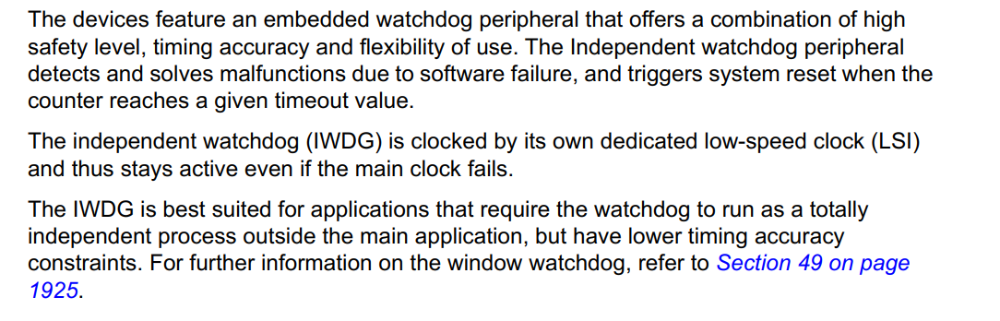
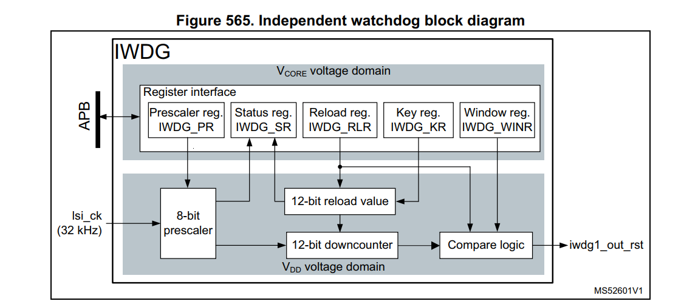
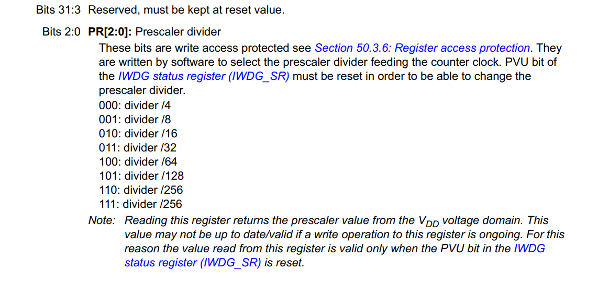
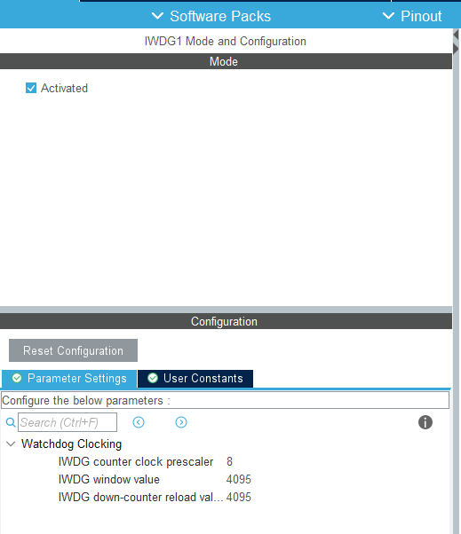
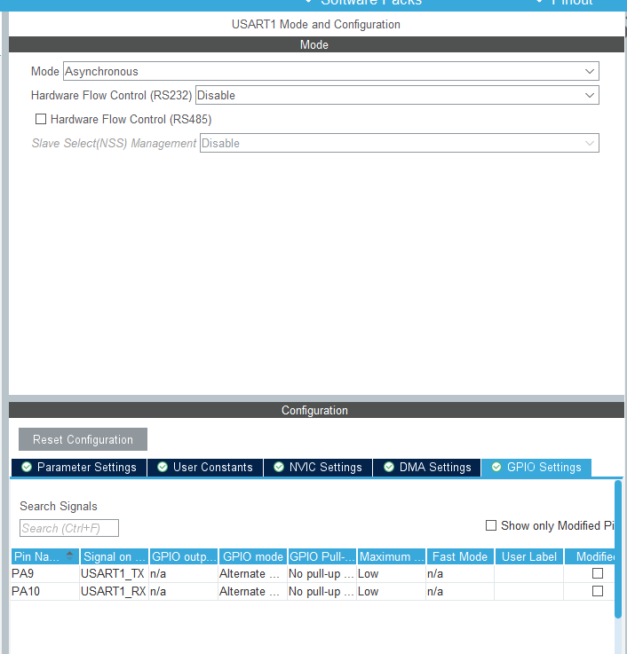
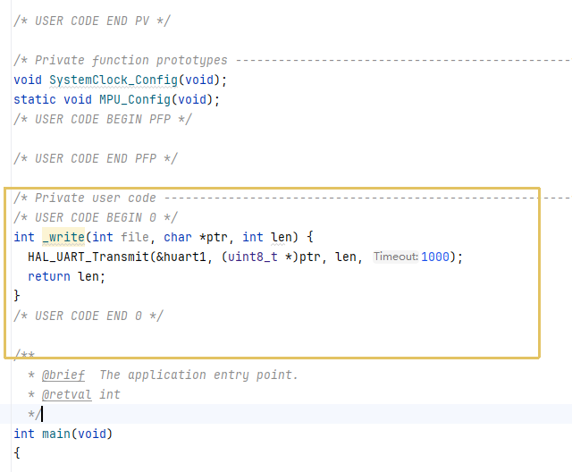
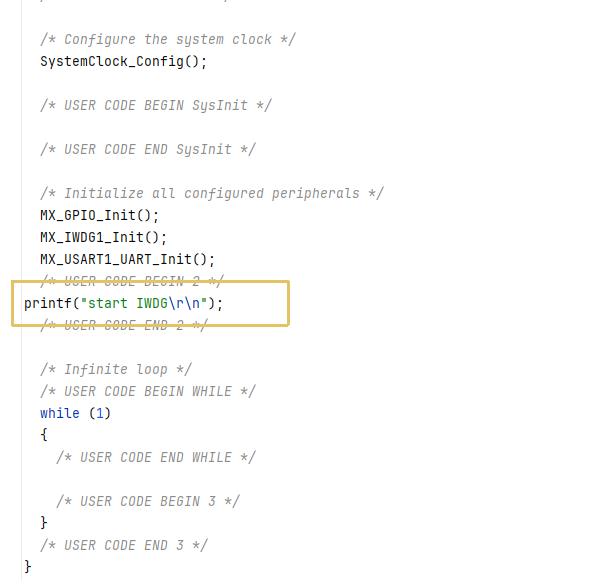
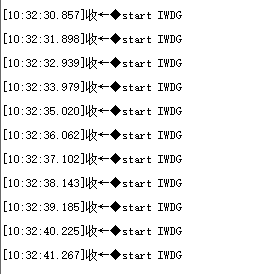
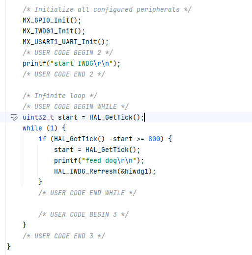
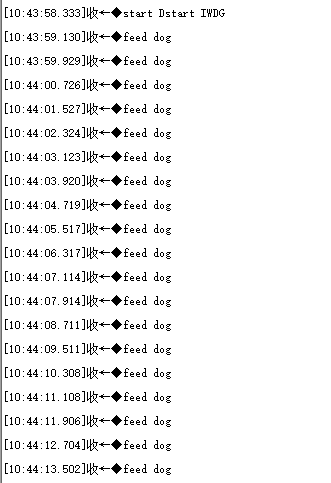

# IWDG

## 前言 

独立看门狗是内置的外设，有内部低速时钟进行驱动

LSI内部低速时钟(32768Hz)通过8位预分频寄存器分频后开始计数，按照分频后的频率将12位重装载的值-1，当重装载的值被减到0时就触发了看门狗，系统复位，开发过程中，我们要认为定期重新设定12位重装载的值，避免系统复位称为喂狗，当程序跑飞一直无法触发喂狗操作才会触发看门狗复位避免程序跑飞。

分频原理（以1秒为例）

系统时钟32KHz

预分频 8  余32768/8 = 4096

重装载 4095 余 4096/(4095+1) = 1

实现1s溢出

预分频寄存器PR只用了3位PR[2:0]表示分频系数

- 000 4分频

- 001 8分频
- 010 16分频
- 011 32分频
- 100 64分频
- 101 128分频
- 110 256分频
- 111 256分频

## HAL库配置

配置独立看门狗

配置串口

## 代码测试

HAL库默认会自动开启看门狗无需手动开启

在main函数前重写打印函数

在main函数`while(1)`前打印日志先不进行`喂狗`操作

每隔1s左右就会触发复位

每隔800ms喂狗一次

未出现复位现象
