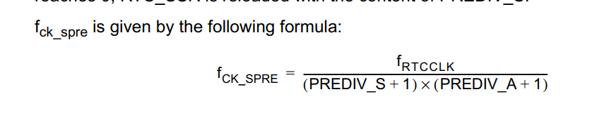
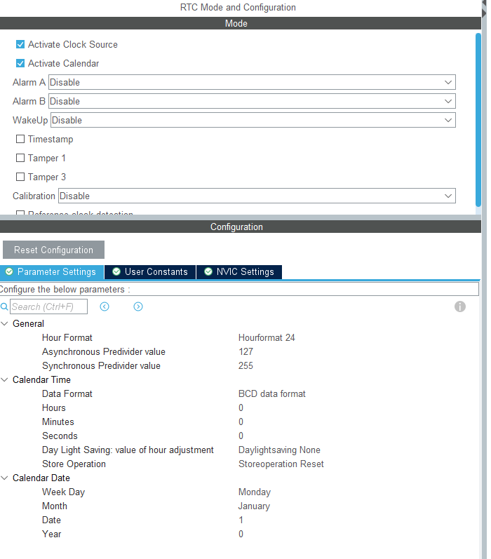
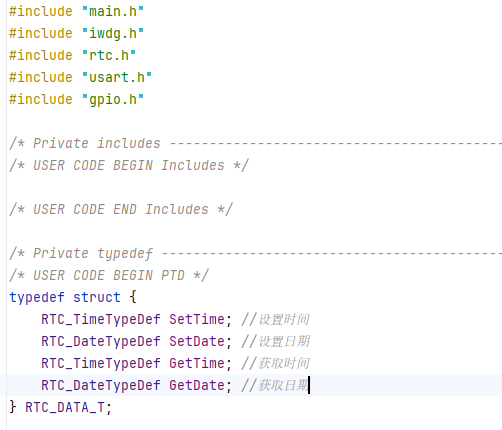
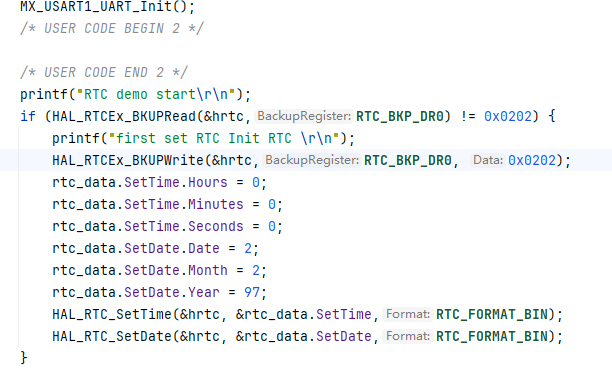
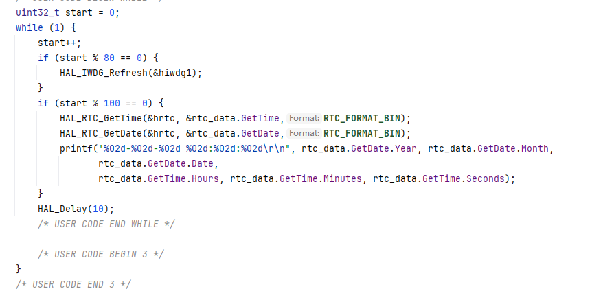
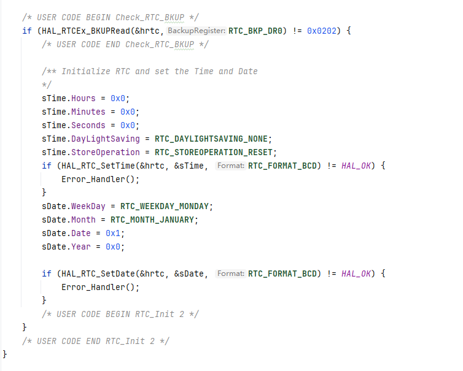
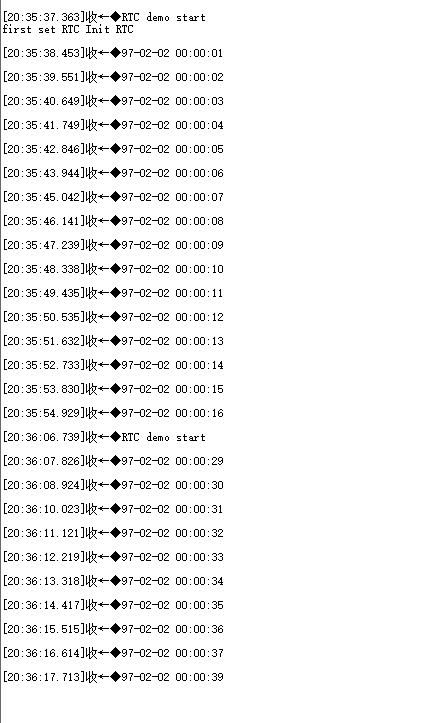

# RTC

## 前言

RTC是一个独立的BCD定时器/计数器，RTC还提供了具有可编程闹钟中断功能的日历，同时还能唤醒低功耗功能。具有两个32位寄存器包含秒、分、时、日、周、月和年。RTC的计数值存储在后备域，即使系统掉电只要后备域有电时钟就不会丢失

RTC有2个预分频寄存器：7位的异步预分频器和15位的同步预分频器，官方推荐将异步预分频器配置较高的值而降低工耗，RTC的时钟可由LSE、LSI和HSE进行分频提供，一般都选择LSI做为RTC的时钟。分频计算公司如下：

如果想实现1S的计数则 异步预分频器设置最大127，32768÷(127+1) = 256，同步预分频器设置255，256÷(255+1) = 1Hz 

此案例只做RTC实时时钟，不对闹钟、日历、低功耗唤醒进行赘述

## HAL库配置

Parameters Setting说明

- General

  - Hour format ：配置12/24小时制，可选Hourformat 24、Hourformat 12
  - Asynchronous Predivider value ：异步预分频 设置范围 0-127
  - Synchronize Predivider value ：同步预分频 设置范围 0-32767

- Calendar Time

  - Date Format：日期格式十进制/二进制 ，可选BCD data format 、Binary data format
  - Hour：设置小时
  - Minutes：设置分钟
  - Second：设置秒
  - Day Light Saving: value of hour adjustment：夏令时，可选DayLightSaving None(无)、DayLightSaving Sub1h(-1h)、DayLightSaving Add1h(+1h)
  - Store Operation :存储操作，可选StoreOperation Reset(复位存储)、StoreOperation Set（设置存储）

- Calendar Date

  - Week Day 设置星期几， 可选Mondy(周一) -Sunday（周日）

  - Month  设置几月 ，可选January（一月）- December（十二月）

  - Date 设置几天，可选1-31

  - Year 设置哪年 可选0-99

    

## 代码

### 1.创建RTC结构体用于设置/获取时间

### 2.初始化时间日期

### 3.获取并打印时间日期

### 4.处理HAL库生成的MX_RTC_Init()函数RTC初始化逻辑

如果这段初始化不加校验则每次启动时都会将时间重置

**注意：** 设置/获取日期的时候需要先操作时间再操作日期否则会出问题

## 测试

首次启动则将初始的时间、日期设置到RTC，然后会每秒更新，中途掉电几秒后再上电时间并没有错乱